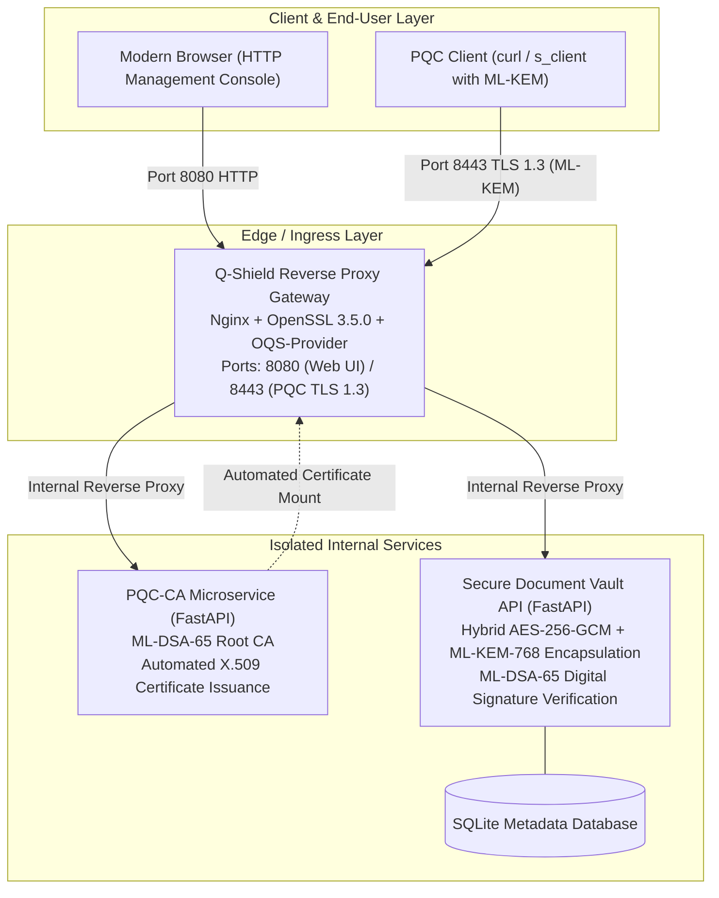

# Q-Shield Platform
## Post-Quantum Zero-Trust Gateway, Automated PQC-CA & Secure Document Vault

Q-Shield is a comprehensive, production-grade cybersecurity platform implementing the official **NIST Post-Quantum Cryptography standards**:
- **NIST FIPS 203**: **ML-KEM-768** (Module-Lattice-Based Key-Encapsulation Mechanism, based on CRYSTALS-Kyber) for quantum-resistant key establishment.
- **NIST FIPS 204**: **ML-DSA-65** (Module-Lattice-Based Digital Signature Algorithm, based on CRYSTALS-Dilithium) for quantum-resistant authentication and digital signatures.

The platform protects modern web traffic and long-lifecycle sensitive data against **"Harvest Now, Decrypt Later" (HNDL)** attacks.

---

## Architecture Overview



---

## Core System Modules

### 1. PQC Ingress Gateway (`/gateway`)
- **Engine**: Nginx 1.24.0 compiled against OpenSSL 3.5.0 and Open Quantum Safe (`oqs-provider`).
- **Protocols**: TLS 1.3 strictly enabled.
- **Key Exchange Groups**: Supports Hybrid (`X25519MLKEM768`) and Pure PQC (`MLKEM768`, `p384_mlkem768`).
- **Authentication**: Certified by an internal **ML-DSA-65** X.509 Certificate (15,616-bit Lattice Public Key).
- **Dual Listener**:
  - `Port 8080`: Management Console & Web Dashboard (accessible by any standard browser).
  - `Port 8443`: Strict Post-Quantum HTTPS Gateway.

### 2. Automated PQC-CA Microservice (`/pqc-ca`)
- **Role**: Internal Certificate Authority replacing legacy RSA/ECC CAs with Post-Quantum Lattice signatures.
- **Root CA**: Self-initialized Root CA running ML-DSA-65 with 10-year validity.
- **Endpoints**:
  - `GET /api/ca/root-info`: Retrieve technical parameters of Root CA.
  - `GET /api/ca/root-cert`: Download `qshield_root_ca_mldsa65.crt`.
  - `POST /api/ca/issue`: Automated issuance of X.509 PQC server/client certificates via REST JSON request.
  - `GET /api/ca/certificates`: Query active certificate registry.

### 3. Secure Document Vault (`/vault-backend`)
- **Threat Mitigated**: Prevents future decryption of archived sensitive records (medical dossiers, financial transactions, legal contracts).
- **Hybrid Cryptographic Flow**:
  1. **Integrity & Non-Repudiation**: Hashes raw payload with SHA-256 and signs with **ML-DSA-65** (FIPS 204).
  2. **Session Key Protection**: Encapsulates a 256-bit Data Encryption Key (DEK) using **ML-KEM-768** (FIPS 203).
  3. **Data Encryption**: Encrypts file payload using **AES-256-GCM** (Authenticated Encryption).
- **Endpoints**:
  - `POST /api/vault/upload`: Encrypt and sign document.
  - `GET /api/vault/documents`: List secured documents.
  - `GET /api/vault/verify/{id}`: Verify ML-DSA-65 digital signature integrity.
  - `GET /api/vault/download/{id}`: Decapsulate via ML-KEM private key, decrypt AES-256-GCM, and download plaintext.

### 4. Cybersecurity Dashboard (`/dashboard`)
- **User Interface**: High-tech Dark Mode console without bloated dependencies.
- **TLS Inspector**: Real-time inspection of active ciphersuites and KEM groups.
- **Drag-and-Drop Vault**: One-click file encryption, signature verification modal, and decryption downloader.
- **CA Management**: Interactive certificate issuance and Root CA downloader.
- **Benchmark Suite**: Interactive Chart.js graphs illustrating the cryptographic overhead trade-offs between RSA/ECC and ML-KEM/ML-DSA.

---

## Quick Start (Docker Compose)

### Prerequisites
- Docker Engine & Docker Compose (v2.x+)
- Windows (WSL2), Linux, or macOS

### 1. Launch the Complete Platform
```bash
git clone https://github.com/VDHieu0612/q-shield.git
cd q-shield

# Build and start all services
docker compose up -d
```

### 2. Access the Applications
- **Web Management Dashboard**: Open [http://localhost:8080](http://localhost:8080) in your browser.
- **PQC HTTPS Gateway**: `https://localhost:8443`
- **PQC-CA Service API**: [http://localhost:8001](http://localhost:8001)
- **Document Vault API**: [http://localhost:8000](http://localhost:8000)

---

## Verification & Testing

### 1. Verify PQC Handshake via Containerized Toolchain
```bash
# Check TLS 1.3 handshake with ML-KEM-768 and ML-DSA-65
docker exec -it qshield-gateway openssl s_client -connect localhost:8443 -curves MLKEM768
```
**Expected Output:**
```text
Certificate chain
0 s:CN=localhost, O=Q-Shield Security, OU=Issued Services
  i:CN=Q-Shield Post-Quantum Root CA, O=Q-Shield Security, OU=PKI Authority
  a:PKEY: ML-DSA-65, 15616 (bit); sigalg: ML-DSA-65
...
Negotiated TLS group: MLKEM768
Protocol: TLSv1.3
Cipher: TLS_AES_256_GCM_SHA384
```

### 2. Send PQC HTTPS Request
```bash
docker exec -it qshield-gateway curl -k --curves MLKEM768 https://localhost:8443/
```

### 3. Issue a Custom PQC Certificate via API
```bash
curl -X POST http://localhost:8001/api/ca/issue \
  -H "Content-Type: application/json" \
  -d '{"common_name": "api.internal.local", "san": ["api.internal.local", "10.0.0.1"], "valid_days": 365}'
```

---

## Quantitative Comparison Matrix

| Algorithm Family | Mechanism | Public Key Size | Ciphertext / Signature | Quantum Security | Overhead Impact |
| :--- | :--- | :--- | :--- | :--- | :--- |
| **RSA-2048** (Classical) | Key Exchange / Signature | 256 bytes | 256 bytes | Broken by Shor | Baseline |
| **ECDHE / ECDSA (P-256)** | Elliptic Curve | 64 bytes | 64 bytes | Broken by Shor | Minimal |
| **X25519MLKEM768** (Hybrid) | Classical + Lattice KEM | 1,216 bytes | 1,120 bytes | **Quantum Resistant** | +1.1 KB per handshake |
| **ML-KEM-768** (FIPS 203) | Pure Lattice KEM | 1,184 bytes | 1,088 bytes | **Quantum Resistant** | +1.0 KB per handshake |
| **ML-DSA-65** (FIPS 204) | Module-Lattice Signature | 1,952 bytes | 3,309 bytes | **Quantum Resistant** | +3.3 KB certificate frame |

---

## Integration with Existing Reverse Proxies

To integrate Q-Shield in front of existing infrastructure (e.g. Nginx, Traefik, HAProxy):
1. Configure Q-Shield Gateway as an **Edge Ingress Proxy** on port 443 / 8443.
2. In `gateway/nginx.conf`, forward incoming requests via HTTP to your existing reverse proxy internal IP:
```nginx
location / {
    proxy_pass http://internal-existing-proxy:80;
    proxy_set_header Host $host;
    proxy_set_header X-Forwarded-Proto https;
    proxy_set_header X-TLS-Protocol $ssl_protocol;
    proxy_set_header X-TLS-KEM-Group "MLKEM768";
}
```
Existing applications require **zero code changes** while gaining instant Post-Quantum protection.

---

## License

This project is licensed under the Apache 2.0 License.
